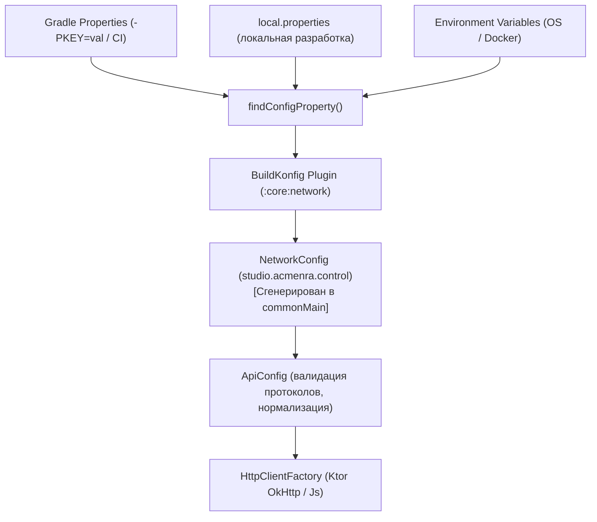

# Документация: Конфигурация сборки (BuildKonfig) и Адаптивная навигация

В данном документе подробно описаны два ключевых архитектурных слоя платформы **CONTROL** (Kotlin Multiplatform):
1. **Система конфигурации сборки (`BuildKonfig` и build-logic)**: генерация типобезопасных параметров окружения для всех платформ (`commonMain`, `androidMain`, `wasmJsMain`) без использования закрытого Android-only `BuildConfig`.
2. **Адаптивная навигационная система (`Navigation Compose` & `AppScaffold`)**: типобезопасные маршруты, адаптивная оболочка (NavigationRail для Desktop/Tablet и NavigationBar для Mobile), реактивная защита авторизацией и интеграция с историей браузера (Wasm).

---

## ЧАСТЬ 1. Конфигурация сборки (`BuildKonfig` и `build-logic`)

### 1.1. Назначение и проблемы мультиплатформенности

В классической Android-разработке конфигурация окружения (URL бэкенда, флаги логирования) формируется через генерируемый класс `BuildConfig`. Однако в **Kotlin Multiplatform (KMP)** класс `BuildConfig` из AGP доступен только в сорс-сетах `androidMain` и недоступен в общем коде `commonMain` или `wasmJsMain`.

Для решения этой задачи в проекте CONTROL используется библиотека **`BuildKonfig`** (`com.codingfeline.buildkonfig` версии `0.23.0`). На этапе компиляции Gradle генерирует статический Kotlin-объект `NetworkConfig` в пакете `studio.acmenra.control`, доступный во всех таргетах без платформенных костылей.



---

### 1.2. Приоритеты источников конфигурации

Разрешение параметров выполняется в `core/network/build.gradle.kts` через специальную функцию каскадного поиска `findConfigProperty(key)`:

```kotlin
val localProperties =
    Properties().apply {
        val file = rootProject.file("local.properties")
        if (file.exists()) file.inputStream().use { load(it) }
    }

fun findConfigProperty(key: String): String? =
    providers.gradleProperty(key).orNull
        ?: localProperties.getProperty(key)
        ?: System.getenv(key)
```

Иерархия приоритета (от высшего к низшему):
1. **Gradle project properties (`-PKEY=value`)**:
   - Передаются из командной строки сборки или пайплайнов CI/CD (например, `./gradlew assembleDebug -PBASE_URL=https://api.control.acmenra.studio/`).
   - Имеют наивысший приоритет, переопределяют любые локальные файлы.
2. **`local.properties` (корень репозитория)**:
   - Предназначен для локальной конфигурации на рабочей станции разработчика.
   - Добавлен в `.gitignore` и никогда не попадает в систему контроля версий.
3. **Environment variables (переменные окружения ОС)**:
   - Считываются через `System.getenv(key)`.
   - Удобны для развертывания в контейнерах Docker и headless-раннерах.
4. **Значения по умолчанию (Fallback)**:
   - Зашиты в блоке `defaultConfigs` таски `buildkonfig`.

---

### 1.3. Спецификация полей `NetworkConfig`

Объект `NetworkConfig` содержит следующие сгенерированные константы:

| Поле | Тип | Значение по умолчанию | Описание и назначение |
| :--- | :--- | :--- | :--- |
| `BASE_URL` | `String` | `""` | Базовый URL бэкенд-сервера API CONTROL |
| `ENABLE_LOGS` | `Boolean` | `false` | Включение HTTP-логирования запросов и ответов в консоль |
| `DEBUG_MODE` | `Boolean` | `false` | Режим отладки (расширенный вывод, форматированный JSON) |
| `ALLOW_INSECURE_TRANSPORT` | `Boolean` | `false` | Разрешение незащищённого протокола `http://` (только для dev) |
| `CONNECT_TIMEOUT_MILLIS` | `Long` | `15000L` | Таймаут установки сетевого TCP/TLS соединения (мс) |
| `REQUEST_TIMEOUT_MILLIS` | `Long` | `30000L` | Общий лимит времени на выполнение HTTP-запроса (мс) |
| `SOCKET_TIMEOUT_MILLIS` | `Long` | `30000L` | Таймаут ожидания очередного пакета данных в сокете (мс) |
| `REFRESH_PATH` | `String` | `"api/auth/refresh"` | Относительный путь к эндпоинту обновления JWT токенов |
| `LOGIN_PATH` | `String` | `"api/auth/login"` | Относительный путь к эндпоинту входа по логину/паролю |

---

### 1.4. Интеграция с доменной валидацией (`ApiConfig`)

Класс `ApiConfig` (`core/network/src/commonMain/kotlin/studio/acmenra/control/core/network/client/ApiConfig.kt`) принимает поля `NetworkConfig` по умолчанию и осуществляет строгую валидацию конфигурации во время выполнения:

```kotlin
data class ApiConfig(
    val apiBaseUrl: String = NetworkConfig.BASE_URL,
    val enableLogs: Boolean = NetworkConfig.ENABLE_LOGS,
    val debugMode: Boolean = NetworkConfig.DEBUG_MODE,
    val allowInsecureTransport: Boolean = NetworkConfig.ALLOW_INSECURE_TRANSPORT,
    val connectTimeoutMillis: Long = NetworkConfig.CONNECT_TIMEOUT_MILLIS,
    val requestTimeoutMillis: Long = NetworkConfig.REQUEST_TIMEOUT_MILLIS,
    val socketTimeoutMillis: Long = NetworkConfig.SOCKET_TIMEOUT_MILLIS,
    val refreshPath: String = NetworkConfig.REFRESH_PATH,
    val loginPath: String = NetworkConfig.LOGIN_PATH,
)
```

#### Правила валидации в `init`:
- **Непустой URL**: Запрещена пустая строка базового адреса. При отсутствии значения выбрасывается понятное исключение:
  `"API base URL must not be blank. Check BASE_URL in local.properties or NetworkConfig."`
- **Защита транспортного уровня**: По умолчанию разрешён исключительно защищённый протокол `https://`. Протокол `http://` допустим только при `allowInsecureTransport = true`.
- **Защита структуры адреса**: Базовый URL не должен содержать query-параметры (`?`), URL-фрагменты (`#`) и пользовательские учетные данные (`user:pass@`).
- **Нормализация слэшей**: Конечный слэш `/` автоматически добавляется к `apiBaseUrl`, а ведущие слэши у путей эндпоинтов (`refreshPath`, `loginPath`) удаляются для безопасной конкатенации в Ktor.

---

### 1.5. Соглашения сборки (`build-logic`)

Сборка стандартизирована с помощью convention-плагинов в каталоге `:build-logic`:

- **`control.convention.kmp.library` (`KmpLibraryPlugin`)**:
  - Подключает KMP (`org.jetbrains.kotlin.multiplatform`) и Android Library (`com.android.kotlin.multiplatform.library`).
  - Настраивает Java 17 compatibility (`JvmTarget.JVM_17`).
  - Конфигурирует запуск Headless Chromium (`CHROME_BIN`) для тестов WasmJS в Karma.
  - Подключает линтинг `ktlint`.
- **`control.convention.kmp.compose` (`KmpComposePlugin`)**:
  - Расширяет библиотечный плагин поддержкой JetBrains Compose Multiplatform (`org.jetbrains.compose`).
  - Добавляет базовые зависимости Compose: `runtime`, `foundation`, `material3`, `ui`, `components-resources`.
- **`control.convention.android.app` (`AndroidAppPlugin`)**:
  - Точка сборки мобильного приложения Android: minSdk 24, compileSdk/targetSdk 37.
- **`control.convention.wasm.app` (`WasmAppPlugin`)**:
  - Точка сборки веб-приложения WasmJS с бандлером Webpack (`control-web.js`).

> [!NOTE]
> В модуле `:core:ui` в блоке `compose.resources` включён флаг `publicResClass = true`, что делает сгенерированный класс ресурсов `Res` публичным для использования в модулях `:shared` и фичах без нарушения модульной изоляции.

---

## ЧАСТЬ 2. Адаптивная навигационная система

### 2.1. Архитектура и структура навигации

Навигация в CONTROL построена на базе официальной библиотеки **Navigation Compose 2.10.0-rc01** с использованием типобезопасных маршрутов Kotlin Serialization:

```text
┌────────────────────────────────────────────────────────────────────────┐
│                                 App.kt                                 │
│  - Наблюдает за SessionManager.sessionState                            │
│  - Инициализирует NavHostController                                    │
│  - Оборачивает в AmberTheme, Surface и NoticeHost                      │
└───────────────────────────────────┬────────────────────────────────────┘
                                    │
                                    ▼
┌────────────────────────────────────────────────────────────────────────┐
│                              AppScaffold                               │
│  Условие: sessionState == Authenticated && !isLoginDestination         │
├───────────────────────────────────┬────────────────────────────────────┤
│  Широкие экраны (>= 840dp):       │  Узкие экраны (< 840dp):           │
│  Row {                            │  Scaffold(bottomBar = {            │
│    AmberNavigationRail(...)       │    AmberNavigationBar(...)         │
│    Box(weight(1f)) { AppNavHost } │  }) { innerPadding -> AppNavHost } │
│  }                                │                                    │
└───────────────────────────────────┴────────────────────────────────────┘
```

---

### 2.2. Типобезопасные маршруты (`AppRoute.kt`)

Вместо подверженных опечаткам строковых путей (`"login"`, `"events"`) используются строго типизированные Kotlin-объекты с аннотациями `@Serializable` и `@SerialName`:

```kotlin
@Serializable
@SerialName("login")
data object LoginRoute

@Serializable
@SerialName("events")
data object EventsRoute
```

#### Преимущества типизации:
1. Ошибки маршрутизации выявляются на этапе компиляции, а не во время работы приложения.
2. Поддержка безопасной передачи аргументов через свойства классов (в будущих экранах).
3. Прямая интеграция с Kotlinx Serialization для сохранения состояния и истории браузера.

---

### 2.3. Синхронизация сессии и защита маршрутов (`AppNavHost.kt`)

`AppNavHost` отслеживает изменения состояния аутентификации (`SessionState`) и текущего экрана в `LaunchedEffect`:

```kotlin
@Composable
fun AppNavHost(
    navController: NavHostController,
    startDestination: Any,
    sessionState: SessionState,
    modifier: Modifier = Modifier,
) {
    val backStackEntry by navController.currentBackStackEntryAsState()
    val destination = backStackEntry?.destination

    LaunchedEffect(sessionState, destination) {
        when {
            sessionState == SessionState.Authenticated &&
                destination?.hasRoute<LoginRoute>() == true -> {
                navController.navigateToEvents()
            }

            sessionState != SessionState.Authenticated &&
                destination?.hasRoute<EventsRoute>() == true -> {
                navController.navigateToLogin()
            }
        }
    }
    // ... NavHost графы
}
```

#### Поведение защиты:
- **Успешный вход**: При смене сессии на `SessionState.Authenticated` контроллер мгновенно переходит на `EventsRoute`, вычищая экран входа из бэкстека (`popUpTo<LoginRoute> { inclusive = true }`).
- **Истечение сессии или логаут**: При переходе в `SessionState.Unauthenticated` или `SessionExpired` пользователя принудительно возвращает на `LoginRoute`.
- **Защита контента**: Если неавторизованный пользователь каким-либо образом оказывается на `composable<EventsRoute>`, вместо экрана отображается центрированный `CircularProgressIndicator`, пока не сработает редирект.

---

### 2.4. Модель элементов навигации (`AppNavigationItem.kt`)

Для расширяемого управления верхнеуровневыми разделами меню реализован интерфейс `AppNavigationItem`:

```kotlin
sealed interface AppNavigationItem {
    val labelRes: StringResource
    val iconRes: DrawableResource

    fun isSelected(destination: NavDestination?): Boolean
    fun navigate(navController: NavController)

    data object Events : AppNavigationItem {
        override val labelRes: StringResource = Res.string.nav_item_events
        override val iconRes: DrawableResource = Res.drawable.ic_nav_events

        override fun isSelected(destination: NavDestination?): Boolean =
            destination?.hasRoute<EventsRoute>() == true

        override fun navigate(navController: NavController) {
            navController.navigateToEvents()
        }
    }

    companion object {
        val DEFAULT_ITEMS: List<AppNavigationItem> = listOf(Events)
    }
}
```

> [!TIP]
> При добавлении новых модулей системы (Devices, Reports, Dictionaries, Audit) достаточно добавить новый `data object` в интерфейс `AppNavigationItem` и включить его в `DEFAULT_ITEMS`. Панели навигации подхватят новый элемент автоматически.

---

### 2.5. Дизайн-система компонентов навигации (`AmberNavigation.kt`)

Компоненты навигации вынесены в `:core:ui` (`studio.acmenra.control.core.ui.components.AmberNavigation.kt`) и строго следуют спецификации `AmberTheme`:

1. **`AmberNavigationBar` (Material 3 Mobile Navigation Bar)**:
   - Высота: `AmberDimens.NavBarHeight` (`80.dp`).
   - Фон: `MaterialTheme.colorScheme.surfaceContainer`.
   - Активный индикатор: `MaterialTheme.colorScheme.secondaryContainer`.
   - Активный цвет иконки: `MaterialTheme.colorScheme.onSecondaryContainer`.
   - Текст/неактивные элементы: `MaterialTheme.colorScheme.onSurfaceVariant`.
2. **`AmberNavigationRail` (Material 3 Desktop/Tablet Navigation Rail)**:
   - Ширина: `AmberDimens.RailCollapsed` (`96.dp`).
   - Высота: `.fillMaxHeight()` на всю вертикаль окна.
   - Фон: `MaterialTheme.colorScheme.surfaceContainer` (создаёт чёткий контраст с рабочей областью `surface`).
   - Отступ сверху: `AmberDimens.RailTopPadding` (`24.dp`) через встроенный `Spacer` в слоте `header`, что исключает прилипание значков к верхнему краю экрана/окна.

---

### 2.6. Адаптивная оболочка (`AppScaffold.kt`)

Компонент `AppScaffold` обеспечивает адаптивное поведение приложения в зависимости от размеров экрана устройства:

```kotlin
val isDesktopOrTablet = maxWidth >= AmberDimens.TabletBreakpoint // 840.dp
```

| Устройство / Сценарий | Брейкпоинт | Компонент навигации | Поведение лейаута |
| :--- | :--- | :--- | :--- |
| **Экран логина** | Любой | Панели скрыты | Полноэкранный вход без системных меню |
| **Десктоп (16:9) / Планшет (4:3)** | $\ge 840$dp | `AmberNavigationRail` | Горизонтальный `Row`: меню слева (96dp), контент экрана справа (`weight(1f)`) |
| **Смартфон (9:16)** | $< 840$dp | `AmberNavigationBar` | `Scaffold`: контент по центру с `padding(innerPadding)`, меню закреплено внизу (80dp) |

---

### 2.7. Интеграция с историей браузера на Wasm (`bindToBrowserNavigation`)

В веб-версии (`:webApp`) навигация синхронизирована с историей браузера с помощью API `androidx.navigation.bindToBrowserNavigation()`:

1. **URL Hash Sync**:
   - При переходе на `LoginRoute` адрес в браузере обновляется на `/#login`.
   - При переходе на `EventsRoute` адрес обновляется на `/#events`.
2. **Прямой переход по ссылке**:
   - Открытие пользователем закладки `https://control.acmenra.studio/#events` восстанавливает целевой маршрут.
3. **Кнопки «Назад» / «Вперёд»**:
   - Нажатие аппаратных или браузерных кнопок истории синхронизирует состояние `NavController`.
4. **Безопасность при логауте**:
   - При очистке сессии `navigateToLogin()` удаляет защищённые маршруты из стека с помощью `inclusive = true`, предотвращая возврат на экран событий по кнопке «Назад».

Все сценарии веб-навигации покрыты интеграционными тестами в `BrowserNavigationWasmTest.kt`.
