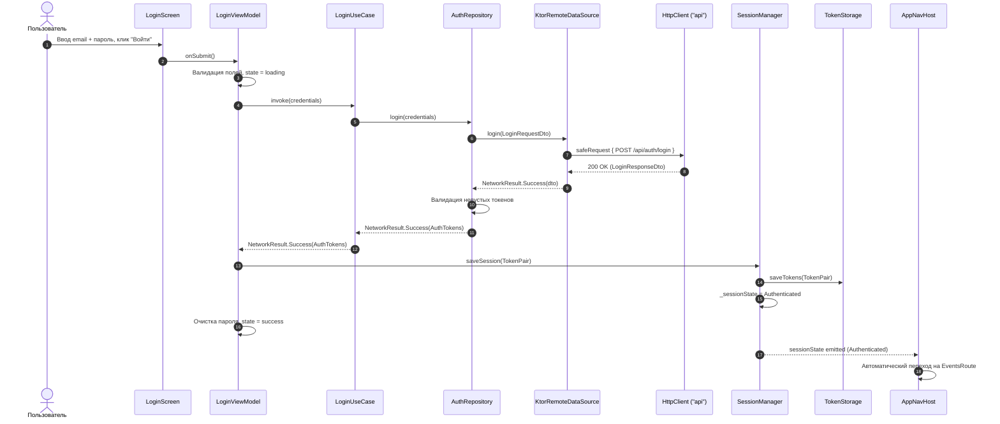
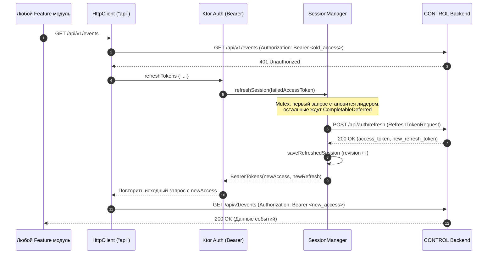

# Документация: Сетевой модуль (`:core:network`) и API Авторизации (`:features:auth`)

Данный документ описывает архитектуру сетевого взаимодействия, механизм сессий и токенов, а также полный цикл аутентификации в проекте **CONTROL** (Kotlin Multiplatform: Android & Kotlin/Wasm).

---

## 1. Архитектурный обзор

В проекте реализовано разделение ответственности в соответствии с принципами **Clean Architecture** и мультиплатформенной спецификой KMP:

```text
┌─────────────────────────────────────────────────────────────┐
│                       :shared (UI/Nav)                      │
│     AppNavHost реагирует на SessionManager.sessionState     │
└──────────────┬──────────────────────────────▲───────────────┘
               │                              │
               ▼                              │
┌─────────────────────────────┐  ┌────────────┴──────────────┐
│       :features:auth        │  │       :core:network       │
│  Presentation:              │  │  Client:                  │
│    LoginViewModel           │  │    HttpClientFactory      │
│    LoginScreen (Compose)    │  │    OriginGuard Plugin     │
│  Domain:                    │  │    SafeRequest wrapper    │
│    LoginUseCase             │  │  Auth:                    │
│    EmailValidator           │  │    SessionManager (Mutex) │
│  Data:                      │  │    SettingsTokenStorage   │
│    AuthRepositoryImpl       │  │  Engine:                  │
│    KtorAuthRemoteDataSource │  │    PlatformEngine (OkHttp/│
└──────────────┬──────────────┘  │                    Js)    │
               │                 └────────────▲──────────────┘
               └──────────────────────────────┘
                    Использует HttpClient ("api")
```

---

## 2. Модуль `:core:network`

Модуль предоставляет платформонезависимый HTTP-клиент, управление безопасными настройками сети, хранение токенов и потокобезопасный менеджер сессий.

### 2.1. Конфигурация сборки (`NetworkConfig` через BuildKonfig) и валидация (`ApiConfig`)

Параметры сетевого уровня генерируются на этапе сборки плагином **BuildKonfig** в объект `NetworkConfig` (`core/network/build.gradle.kts`).

#### Источники конфигурации (в порядке приоритета):
1. **Gradle project properties**: `-PBASE_URL=...` (передаются из командной строки или CI/CD);
2. **`local.properties`**: локальный файл разработчика (не коммитится в Git);
3. **Environment variables**: переменные окружения ОС (например, `export BASE_URL=...`).

#### Доступные параметры конфигурации:
| Параметр | Тип | Значение по умолчанию | Описание |
| :--- | :--- | :--- | :--- |
| `BASE_URL` | String | `""` | Базовый URL API сервера |
| `ENABLE_LOGS` | Boolean | `false` | Логирование сетевых запросов и заголовков |
| `DEBUG_MODE` | Boolean | `false` | Режим отладки (включая pretty-print JSON) |
| `ALLOW_INSECURE_TRANSPORT` | Boolean | `false` | Разрешение незащищенного протокола HTTP |
| `CONNECT_TIMEOUT_MILLIS` | Long | `15000L` | Таймаут установки соединения |
| `REQUEST_TIMEOUT_MILLIS` | Long | `30000L` | Общий таймаут выполнения HTTP-запроса |
| `SOCKET_TIMEOUT_MILLIS` | Long | `30000L` | Таймаут ожидания данных в сокете |
| `REFRESH_PATH` | String | `"api/auth/refresh"` | Путь к эндпоинту обновления токенов |
| `LOGIN_PATH` | String | `"api/auth/login"` | Путь к эндпоинту логина |

#### Валидация в `ApiConfig`:
Класс `ApiConfig` инкапсулирует параметры сетевого подключения и валидирует URL при создании каждого экземпляра (включая метод `.copy()`):

* **Строгая проверка протокола**: По умолчанию разрешён только `https://`. Незащищённый протокол `http://` допустим только при явном флаге `allowInsecureTransport = true` (для локальной разработки).
* **Защита структуры URL**: Запрещены пустые хосты, query-параметры (`?key=value`), фрагменты (`#hash`) и учётные данные (`user:pass@host`).
* **Нормализация**: Базовый URL всегда завершается одиночным слэшем `/`.

```kotlin
val config = ApiConfig(
    apiBaseUrl = NetworkConfig.BASE_URL,
    enableLogs = NetworkConfig.ENABLE_LOGS,
    debugMode = NetworkConfig.DEBUG_MODE,
    allowInsecureTransport = NetworkConfig.ALLOW_INSECURE_TRANSPORT,
    connectTimeoutMillis = NetworkConfig.CONNECT_TIMEOUT_MILLIS,
    requestTimeoutMillis = NetworkConfig.REQUEST_TIMEOUT_MILLIS,
    socketTimeoutMillis = NetworkConfig.SOCKET_TIMEOUT_MILLIS,
    refreshPath = NetworkConfig.REFRESH_PATH,
    loginPath = NetworkConfig.LOGIN_PATH,
)
```

### 2.2. Фабрика клиентов (`HttpClientFactory`)

Для исключения утечки авторизационных данных фабрика предоставляет два типа клиентов:

1. **API Client (`createApiClient`)**:
   * Предназначен **исключительно** для взаимодействия с основным бэкендом приложения.
   * Устанавливает базовый URL и заголовок `Accept: application/json`.
   * **`OriginGuard` Plugin**: перехватывает все исходящие запросы и выбрасывает `IllegalArgumentException`, если запрос направлен на хост или порт, отличный от сконфигурированного `apiBaseUrl`. Это гарантирует, что JWT-токены никогда не уйдут на внешние хосты.
   * **Санитизация логов**: заголовки `Authorization`, `Cookie` и `Set-Cookie` маскируются в логах.
   * **Таймауты**: настроены таймауты подключения, запроса и чтения сокета.
   * **Движок**: OkHttp на Android, Js / Fetch API на Web (Wasm).

2. **External Client (`createExternalClient`)**:
   * Предназначен для скачивания медиа, запросов к S3, CDN или сторонним веб-сервисам.
   * **Не содержит** плагина `Auth` и не подставляет Bearer-токены.

### 2.3. Хранение токенов (`TokenStorage` и `SettingsTokenStorage`)

Интерфейс `TokenStorage` абстрагирует сохранение пары токенов (`accessToken`, `refreshToken`).

* Реализация `SettingsTokenStorage` использует библиотеку `multiplatform-settings`:
  * На Android: платформенные `SharedPreferences` (или `EncryptedSharedPreferences`).
  * На Wasm: `localStorage` браузера.
* Токены проверяются на валидность методом `isValid()` (`isNotBlank()` для обоих токенов).

### 2.4. Менеджер сессий (`SessionManager`)

`SessionManager` является единым источником правды о состоянии аутентификации пользователя (`SessionState`):

```kotlin
sealed interface SessionState {
    data object Unauthenticated : SessionState
    data object Authenticated : SessionState
    data object SessionExpired : SessionState
}
```

#### Ключевые механизмы `SessionManager`:
* **Потокобезопасность**: раздельные `Mutex` для операций с хранилищем токенов и для процесса обновления токенов.
* **Дедупликация refresh-запросов (SingleFlight)**: если одновременно несколько запросов получают HTTP 401, только первый запрос (лидер) выполняет фактический сетевой вызов `POST /api/auth/refresh`. Остальные запросы подписываются на `CompletableDeferred` и ждут его завершения, предотвращая параллельный вызов рефреша.
* **Версионирование сессии (`currentRevision`)**: оптимистичная блокировка предотвращает перезапись новых токенов устаревшими ответами.
* **Сброс сессии**: при подтверждении смерти `refreshToken` (ошибки OAuth `invalid_grant`, `invalid_token`, `token_expired`) хранилище очищается, а состояние переходит в `SessionState.SessionExpired`.

### 2.5. Безопасные запросы (`SafeRequest`) и ошибки (`NetworkResult`)

Функция-расширение `HttpClient.safeRequest<T>` оборачивает сетевые вызовы в типизированный результат:

```kotlin
sealed interface NetworkResult<out T> {
    data class Success<T>(val data: T, val statusCode: Int = 200) : NetworkResult<T>
    data class Failure(val error: NetworkError) : NetworkResult<Nothing>
}
```

#### Типы сетевых ошибок (`NetworkError`):
* `NetworkError.Http(statusCode, message, errorBody)` — ответ сервера с кодом `4xx` или `5xx`.
* `NetworkError.Connectivity(message, cause)` — обрыв связи, таймаут, DNS lookup failure, Fetch failure в браузере. Анализирует всю цепочку `cause` с защитой от циклических ссылок.
* `NetworkError.Serialization(message, cause)` — несоответствие структуры JSON или поврежденные данные.
* `NetworkError.Unknown(message, cause)` — непредвиденные исключения среды выполнения.

> [!IMPORTANT]
> `safeRequest` гарантированно пробрасывает `CancellationException` (не нарушая структурированную конкурентность корутин) и критические ошибки JVM/среды (`OutOfMemoryError`, `StackOverflowError`, `AssertionError`), не превращая их в ложный `Failure`.

---

## 3. Спецификация API Авторизации

### 3.1. Эндпоинт входа (`login`)

* **URL**: `POST /api/auth/login`
* **Content-Type**: `application/json`
* **Аутентификация**: Не требуется

#### Тело запроса (`LoginRequestDto`):
```json
{
  "email": "operator@control.acmenra.studio",
  "password": "SecurePassword123!"
}
```

#### Успешный ответ (`200 OK`, `LoginResponseDto`):
```json
{
  "access_token": "eyJhbGciOiJIUzI1NiIsInR5cCI6IkpXVCJ9...",
  "refresh_token": "d9b2e841-3b7c-4a31-92e1-88f2868da567"
}
```

#### Возможные коды ошибок:
| Код | Описание | Причина / Обработка на клиенте |
| :--- | :--- | :--- |
| `400 Bad Request` | Неверный запрос | Ошибки валидации формата email или пароля на стороне сервера |
| `401 Unauthorized` | Неверные учетные данные | Неправильный логин или пароль |
| `403 Forbidden` | Доступ запрещен | Аккаунт заблокирован или нет прав |
| `404 Not Found` | Эндпоинт не найден | Неверный базовый URL или устаревшая версия API |
| `429 Too Many Requests` | Превышен лимит | Сработал rate limiting (брутфорс-защита) |
| `500 Internal Error` | Ошибка сервера | Внутренняя ошибка бэкенда |
| `503 Unavailable` | Сервис недоступен | Технические работы или недоступность шлюза |

---

### 3.2. Эндпоинт обновления токенов (`refresh`)

* **URL**: `POST /api/auth/refresh`
* **Content-Type**: `application/json`
* **Вызывается автоматически**: Ktor `Auth.bearer` плагином при получении `401 Unauthorized` на защищенных API-запросах.

#### Тело запроса (`RefreshTokenRequest`):
```json
{
  "refresh_token": "d9b2e841-3b7c-4a31-92e1-88f2868da567"
}
```

#### Успешный ответ (`200 OK`, `RefreshTokenResponse`):
```json
{
  "access_token": "eyJhbGciOiJIUzI1NiIsInR5cCI6IkpXVCJ9.new...",
  "refresh_token": "optional-rotated-refresh-token"
}
```
*Если `refresh_token` в ответе опущен (`null`), клиент сохраняет текущий `refresh_token`.*

#### Ошибки инвалидации сессии:
Если сервер возвращает `400 Bad Request` или `401 Unauthorized` с телом:
```json
{
  "error": "invalid_grant",
  "error_description": "Refresh token is expired or revoked"
}
```
`SessionManager` инвалидирует сессию, переводит приложение в `SessionState.SessionExpired`, и пользователь перенаправляется на экран логина.

---

## 4. Модуль `:features:auth`

### 4.1. Слой данных (Data)
* `AuthRemoteDataSource` / `KtorAuthRemoteDataSource`: отправляет `POST api/auth/login` через `httpClient.safeRequest`.
* `AuthRepositoryImpl`:
  * Вызывает `AuthRemoteDataSource`.
  * Валидирует токены ответа (защита от пустых строк `accessToken` / `refreshToken`).
  * Маппит `LoginResponseDto` в доменную сущность `AuthTokens`.

### 4.2. Доменный слой (Domain)
* `LoginCredentials`: данные учетной записи (`email`, `password`).
* `AuthTokens`: пара токенов в доменной модели.
* `EmailValidator`: регулярное выражение и проверка доменной зоны с поддержкой поддоменов и интернациональных адресов.
* `LoginUseCase` / `LoginUseCaseImpl`: сценарий аутентификации.

### 4.3. Слой представления (Presentation)
* `LoginViewModel`:
  * Содержит реактивное состояние `StateFlow<LoginState>`.
  * Валидирует поля ввода (непустой пароль, корректный email).
  * Вызывает `loginUseCase.invoke(credentials)`.
  * При успехе вызывает `sessionManager.saveSession(tokens)` и **очищает поле пароля**.
  * Преобразует ошибки сети в локализованные уведомления `Notice.error(...)` с параметрами (код статуса HTTP).
  * Корректно перехватывает `TimeoutCancellationException`, сбрасывая `isLoading = false`, и пробрасывает настоящие `CancellationException`.
* `LoginScreen`:
  * Адаптивная форма на Compose Multiplatform в стиле дизайн-системы `AmberTheme`.
  * Поддержка скролла (`verticalScroll`), отступов системной клавиатуры (`imePadding()`).
  * Переключение видимости пароля, обработка клавиши `Done` / `Go`.

---

## 5. Диаграммы последовательности

### 5.1. Успешный вход в систему



### 5.2. Прозрачный рефреш токена при истечении Access Token



---

## 6. Внедрение зависимостей (Koin)

В приложении настроены два Koin-модуля:

```kotlin
// 1. Сетевая инфраструктура (:core:network)
val networkModule = module {
    single<TokenStorage> { SettingsTokenStorage() }
    single { ApiConfig() }
    single { SessionManager(tokenStorage = get()) }
    single(named("api")) {
        val config = get<ApiConfig>()
        HttpClientFactory.createApiClient(
            sessionManager = get(),
            apiBaseUrl = config.apiBaseUrl,
            enableLogs = config.enableLogs,
            debugMode = config.debugMode,
            allowInsecureTransport = config.allowInsecureTransport
        )
    }
    single(named("external")) {
        val config = get<ApiConfig>()
        HttpClientFactory.createExternalClient(enableLogs = config.enableLogs)
    }
}

// 2. Аутентификация (:features:auth)
val authModule = module {
    single<AuthRemoteDataSource> {
        KtorAuthRemoteDataSource(httpClient = get(named("api")))
    }
    single<AuthRepository> {
        AuthRepositoryImpl(remoteDataSource = get())
    }
    single<LoginUseCase> {
        LoginUseCaseImpl(authRepository = get())
    }
    viewModel {
        LoginViewModel(
            loginUseCase = get(),
            sessionManager = get()
        )
    }
}
```
